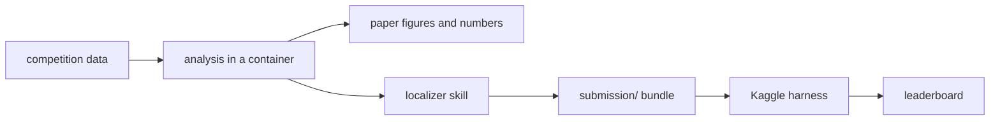

# gemma-4-dev-agent

Our entry for the [Gemma 4 Developer Agent](https://www.kaggle.com/competitions/gemma-4-developer-agent)
competition: a declarative agent config that fixes real Python issues offline on a quantized Gemma 4.
It also holds the research behind our paper, *Where does a code graph help a bug-fixing agent?*
The short answer so far: plain BM25 over the issue text finds the edit site as well as the graph
tools do, so we ship that as a skill.




## Results so far

| Item | Result |
|---|---|
| Baseline bundle, public leaderboard | 0.18 (zip `d66442e9…`; local 3 of 30) |
| Edit-site search, 116 tasks, hit@10 | BM25 55%, BM25 then call graph 54%, then embeddings 50% |
| Localizer skill, same tasks | 56.9% hit@10, about 0.2 s per task |
| Same-file sibling list, 50 multi-site tasks | 63% recall, 13.5% precision |
| Skill in the agent, 36 dev tasks, 2 replicates | baseline 13, 15 resolved; skill 14, 14 (no effect detected) |

Every number is tagged in [`docs/QUESTIONS.md`](docs/QUESTIONS.md); the paper draft is
[`paper/DRAFT.md`](paper/DRAFT.md).

## Quick start

Needs [uv](https://docs.astral.sh/uv/), Docker and the `kaggle` CLI (logged in, rules accepted).

```
make setup                            # dev tools and the pre-push hook
make check                            # lint, unit tests, submission pre-flight
make zip                              # dist/submission.zip, the bundle Kaggle scores
python scripts/fetch_data.py --snapshots scored   # competition data into data/ (19 GB)
make score-local                      # score the localizer in an isolated container
```

The competition data stays on your machine: its rules forbid sharing it, so the repo holds only
aggregates and code. Details are in [`docs/COMPETITION.md`](docs/COMPETITION.md).

## Where things are

| Path | What |
|---|---|
| `submission/` | the agent bundle (YAML, prompts) |
| `experiments/` | run log (`runs.csv`), the localizer skill, probe bundles |
| `analysis/`, `pod/` | analysis scripts; `pod/` also runs on a RunPod CPU pod |
| `synthetic/` | synthetic task generator: mutation, graphs, embeddings, export |
| `docs/` | competition notes, plans, ablation plan, decisions (`adr/`) |

## Contributing

Branch off `main`, open a PR, and let CI pass; conventions are in [`CLAUDE.md`](CLAUDE.md).

## License

Apache-2.0 ([ADR-0001](docs/adr/0001-license-apache-2.md)). LoRA adapters also fall under the Gemma
Terms of Use. The bundle adapts a public Kaggle notebook; credit is in
[`docs/ATTRIBUTION.md`](docs/ATTRIBUTION.md).
