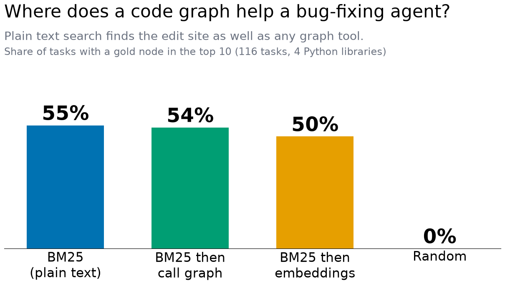
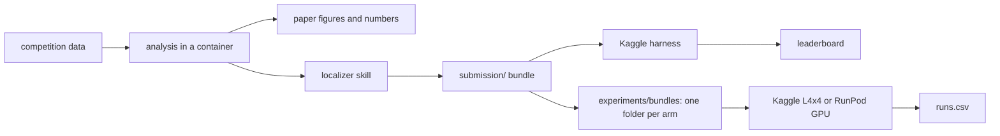

# gemma-4-dev-agent

Our entry for the [Gemma 4 Developer Agent](https://www.kaggle.com/competitions/gemma-4-developer-agent)
competition: a declarative agent config that fixes real Python issues offline on a quantized Gemma 4.
It also holds the research behind our paper, *Where does a code graph help a bug-fixing agent?*
The short answer so far: plain BM25 over the issue text finds the edit site as well as the graph
tools do, and handing that to the agent as a skill did not change how many tasks it solves.





## Results so far

36 dev tasks (rich held out), resolved per replicate. Every number is tagged in
[`docs/QUESTIONS.md`](docs/QUESTIONS.md); the paper draft is [`paper/DRAFT.md`](paper/DRAFT.md).

| Item | Result |
|---|---|
| Baseline bundle, public leaderboard | 0.18 (zip `d66442e9…`; local 3 of 30) |
| Edit-site search, 116 tasks, hit@10 | BM25 55%, BM25 then call graph 54%, then embeddings 50% |
| 31B baseline | 13 and 15 of 36 (about 39%) |
| Localizer skill in the agent | 14 and 14 of 36: no effect detected |
| Run-a-test prompt | 15 of 36, one replicate: the agent ignored the instruction |
| Small models, baseline prompt | E4B 5 of 36, E2B 6 of 36, one replicate each, about 0.5 USD each |
| What separates solved tasks | gold-patch size (median 5 lines solved, 22 never solved), not where the agent looks |

## Quick start

Needs [uv](https://docs.astral.sh/uv/), Docker and the `kaggle` CLI (logged in, rules accepted).

```
make setup                            # dev tools and the pre-push hook
make check                            # lint, unit tests, submission pre-flight
make zip                              # dist/submission.zip, the bundle Kaggle scores
python scripts/fetch_data.py --snapshots scored   # competition data into data/ (19 GB)
make score-local                      # score the localizer in an isolated container
make task-features                    # relate task features to outcomes (needs data/runs/)
```

The competition data stays on your machine: its rules forbid sharing it, so the repo holds only
aggregates and code. Details are in [`docs/COMPETITION.md`](docs/COMPETITION.md).

## Running a model

No GPU is needed to edit, package or analyse. To run the agent on tasks you need one of:

| Route | Cost | Notes |
|---|---|---|
| Kaggle L4x4 kernel (`make kernel-eval`, `make run-eval`) | free, about 15 h of weekly quota | same hardware as the leaderboard; about 2.9 h per 36-task run of 31B |
| RunPod pod (`pod/job.sh`, `pod/gpu_run.py`) | 31B: about 3.9 USD; E4B or E2B: about 0.5 USD | secure on-demand; data is sent from this machine; a gold-patch check gates the run |
| Colab T4 | free | not tried; reference in `docs/reference/colab/` |

The recipe, prices and pitfalls are in [`docs/GPU_RUNS.md`](docs/GPU_RUNS.md). The RunPod spend cap
is 10 USD in total.

## Where things are

| Path | What |
|---|---|
| `submission/` | the agent bundle (YAML, prompts): the adopted baseline |
| `experiments/` | run log (`runs.csv`), `bundles/` (one folder per arm), the localizer skill, probe bundles |
| `analysis/` | analysis scripts: failure classes, task features, trace review, dev subset |
| `pod/`, `kaggle/` | the pod GPU job and the Kaggle eval-runner kernel builder |
| `synthetic/` | synthetic task generator: mutation, graphs, embeddings, export |
| `docs/` | competition notes, plans, GPU recipe, failure analysis, decisions (`adr/`), `reference/` |

## Contributing

Branch off `main`, open a PR, and let CI pass; conventions are in [`CLAUDE.md`](CLAUDE.md).

## License

Apache-2.0 ([ADR-0001](docs/adr/0001-license-apache-2.md)). LoRA adapters also fall under the Gemma
Terms of Use. The bundle adapts a public Kaggle notebook; credit is in
[`docs/ATTRIBUTION.md`](docs/ATTRIBUTION.md).
