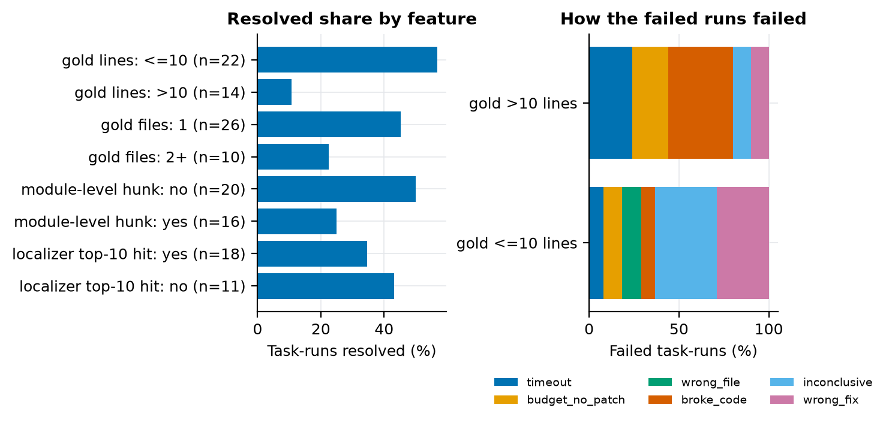

# Which tasks fail, and what they have in common

How the 36 dev tasks relate to their outcomes over five runs. Aggregates only: the competition rules
forbid publishing per-task data (terms 4b), so there are no task ids, issue text, patches or traces
here, and a cell with fewer than 5 tasks is marked `~` (indicative only).
Reproduce: `make task-features` (the tables); `FIG_DIR=docs/img make task-features` adds the figure.
Code: `analysis/task_features.py`.

## What was measured

- **Runs.** Five runs of the same 36 dev tasks (fastapi 30, requests 5, httpx 1; rich held out):
  baseline twice, localizer-skill twice (A40), and the run-a-test prompt once on a rented GPU (A41).
  **Groups** use all five: *stable* = solved in 4 or 5 runs, *flaky* = 1 to 3, *never* = 0.
  **Failure classes** (`analysis/failure_classes.py`) use the four Kaggle runs, because the fifth kept
  only its console log (status, calls and time per task, no patches or test output).
- **Features.** From the gold patch map (A24), counted over library hunks only: files, lines changed,
  mapped nodes, module-level hunks, hunks the graph cannot see (async). From the issue: words, code
  block, whether it names a gold symbol or file module. From the test patch: lines, missing packages
  (A39). From the localizer skill (A37): is a gold node in its top 10? From the traces: did the first
  edit land in a gold file?
- **Counts.** 36 tasks: 12 stable, 8 flaky, 16 never. Pooled class tables count task-runs (36 x 4 =
  144), so one task appears four times and the rows are not independent.

## Findings

1. **The size of the gold patch separates the groups; where the agent looks does not.**
   Median gold lines changed: 5 (stable), 6.5 (flaky), 22.5 (never). Tasks whose gold patch changes
   more than 10 lines resolved in 6 of 56 task-runs (11%), against 50 of 88 (57%) for the rest.
   Ten of the 16 never-solved tasks are in the large bin, against 1 of 12 stable. Only 4 of the 14
   large-patch tasks were solved in any run. The same holds for two or more gold files (9 of 40
   task-runs resolved, 23%, against 47 of 104, 45%) and for module-level hunks (16 of 64, 25%, against
   40 of 80, 50%); those features overlap with size, and with 36 tasks they cannot be pulled apart.
2. **Localization is not what fails.** In a never-solved task the first edit still lands in a gold file
   46 of 62 times (74%), against 28 of 48 (58%) for stable tasks. A gold node is in the localizer's
   top 10 for 7 of 12 never tasks and 5 of 9 stable ones; task-runs with a top-10 hit resolved 25 of
   72 times (35%), without one 19 of 44 (43%). The issue names a gold symbol in 5 of 16 never tasks
   and 6 of 12 stable ones. None of these moves with outcome, which agrees with A37: BM25 finds the
   site, and the agent already edits there.
3. **Failure classes follow patch size.** In large-patch tasks the failed runs are mostly `broke_code`
   (18), `timeout` (12) and `budget_no_patch` (10) of 50. In small-patch tasks they are
   `inconclusive` (13), `wrong_fix` (11), `budget_no_patch` (4), `wrong_file` (4), `broke_code` (3)
   and `timeout` (3) of 38. Budget stops and timeouts together are 29 of 144 task-runs (20%); 13 of
   the 14 budget stops and 9 of the 15 timeouts are in never-solved tasks, and none is in a stable task.
4. **About a third of the never-solved tasks are probably not scoreable here.** Of 16: 3 are
   inconclusive in at least 3 of 4 runs, 2 have a gold patch with no library code (docs only), none
   needs a package the image lacks (the dev subset already drops those), which leaves 11 that look like
   real failures. Ten of those 11 have gold patches over 10 lines.
5. **Tasks with no mapped gold node** (7: docs only or module-level only) are 28 task-runs, of which
   9 are `inconclusive` and 12 resolved; async hunks (6 tasks) did not hurt (13 of 24 task-runs resolved, 54%).

## Tables

Group summary (medians, or a share of tasks; `mean_calls` and `mean_minutes` are the median over
tasks of each task's mean; `first_edit_gold` counts task-runs that made an edit):

| Group | n | gold_files | gold_lines | gold_nodes | issue_words | test_lines | module_level | async_hunk | bm25_hit | names_gold | missing_deps | mean_calls | mean_minutes | first_edit_gold |
|---|---|---|---|---|---|---|---|---|---|---|---|---|---|---|
| stable | 12 | 1 | 5 | 1 | 142.5 | 37.5 | 3/12 | 3/12 | 5/9 | 6/12 | 0/12 | 21.6 | 3.8 | 28/48 |
| flaky | 8 | 1 | 6.5 | 1 | 85 | 40 | 3/8 | 1/8 | 6/8 | 2/8 | 0/8 | 26 | 5.5 | 23/30 |
| never | 16 | 1 | 22.5 | 1.5 | 110.5 | 50 | 10/16 | 2/16 | 7/12 | 5/16 | 0/16 | 27.4 | 5.6 | 46/62 |

Failure classes pooled over the four Kaggle runs (task-runs) by feature bin. `~` marks a bin of
fewer than 5 tasks. "no gold node" means the task has no mapped library node, so no localizer score.

| Feature | Bin | Tasks | resolved | timeout | budget_no_patch | wrong_file | broke_code | inconclusive | wrong_fix |
|---|---|---|---|---|---|---|---|---|---|
| gold files | 1 | 26 | 47 | 7 | 9 | 4 | 9 | 16 | 12 |
| gold files | 2+ | 10 | 9 | 8 | 5 | 0 | 12 | 2 | 4 |
| gold lines | <=10 | 22 | 50 | 3 | 4 | 4 | 3 | 13 | 11 |
| gold lines | >10 | 14 | 6 | 12 | 10 | 0 | 18 | 5 | 5 |
| module-level hunk | no | 20 | 40 | 5 | 3 | 2 | 11 | 8 | 11 |
| module-level hunk | yes | 16 | 16 | 10 | 11 | 2 | 10 | 10 | 5 |
| async hunk | no | 30 | 43 | 10 | 12 | 4 | 17 | 18 | 16 |
| async hunk | yes | 6 | 13 | 5 | 2 | 0 | 4 | 0 | 0 |
| localizer top-10 hit | no | 11 | 19 | 5 | 5 | 2 | 5 | 7 | 1 |
| localizer top-10 hit | no gold node | 7 | 12 | 0 | 3 | 0 | 0 | 9 | 4 |
| localizer top-10 hit | yes | 18 | 25 | 10 | 6 | 2 | 16 | 2 | 11 |
| issue names gold symbol | no | 23 | 32 | 12 | 11 | 4 | 11 | 9 | 13 |
| issue names gold symbol | yes | 13 | 24 | 3 | 3 | 0 | 10 | 9 | 3 |
| issue has code block | no | 26 | 35 | 11 | 11 | 4 | 19 | 12 | 12 |
| issue has code block | yes | 10 | 21 | 4 | 3 | 0 | 2 | 6 | 4 |
| issue words | <150 | 22 | 29 | 10 | 10 | 3 | 12 | 14 | 10 |
| issue words | >=150 | 14 | 27 | 5 | 4 | 1 | 9 | 4 | 6 |
| test lines | <=40 | 18 | 30 | 5 | 8 | 2 | 12 | 6 | 9 |
| test lines | >40 | 18 | 26 | 10 | 6 | 2 | 9 | 12 | 7 |
| missing test deps | no | 36 | 56 | 15 | 14 | 4 | 21 | 18 | 16 |
| repo | fastapi | 30 | 52 | 12 | 13 | 4 | 11 | 15 | 13 |
| repo | httpx | 1~ | 0 | 0 | 0 | 0 | 4 | 0 | 0 |
| repo | requests | 5 | 4 | 3 | 1 | 0 | 6 | 3 | 3 |

Smaller facts: no issue in the dev set contains a traceback (0 of 36), 10 of 36 contain a code block
(resolved 21 of 40 task-runs, 53%, against 35 of 104, 34%, without; this overlaps with patch size).
The run on a rented GPU (L40S) agrees with the Kaggle runs by size: it resolved 13 of 22
small-patch tasks and 2 of 14 large-patch ones.

## Where a lever could exist

- **Real but bounded: the flaky tasks (8).** The four Kaggle runs failed them 24 times: `timeout` 6,
  `wrong_fix` 7, `broke_code` 7, `wrong_file` 3, `budget_no_patch` 1. No single fix covers them. They
  are the only tasks where one prompt change can move the score by more than noise. A Kaggle run
  solves about 2 of the 8 (8 resolved task-runs of 32); solving all of them would add up to 6 tasks,
  about 17 points, at the very best.
- **Edit safety: `broke_code`.** 21 of 144 task-runs (15%), 18 in large-patch tasks and 7 in flaky
  ones. The class means a test log with an import, syntax or name error, so a check after every edit
  (`python -m py_compile` plus an import of the edited module, one call) is the cheapest guard. It
  could free the flaky ones; it will not rescue the large ones.
- **Efficiency: budget stops and timeouts.** 29 task-runs (20%) end without a gradable patch. Of the 14
  budget stops, 11 had already read a gold file, so the agent knew where to edit and ran out of calls
  (the 150-line read window forces paging, TRACE_REVIEW). An earlier first edit or larger reads could
  help here, but 13 of the 14 are in never-solved tasks with large gold patches, so the upside is
  small.
- **Not a lever: finding the file.** 63 of the 84 failed runs that edited (75%) edited a gold file
  first. A better localizer or graph tool targets a step that mostly works.
- **Floor and ceiling.** 12 stable tasks are a floor of 33%. If every flaky task were solved it would
  be 20 of 36 (56%); of the 16 never-solved tasks, about 5 are probably unscoreable, 10 have
  large gold patches that no run came close to, and 1 is a small genuine failure.

## What this does not show

- It is 36 tasks from mostly one repository, with four non-independent Kaggle runs and one run on
  different hardware. Group and bin differences are descriptive, and the size, file-count and
  module-level bins are tangled. Do not read a feature as a cause.
- `broke_code` and `inconclusive` come from regexes over test logs (`failure_classes.py`), and
  `async hunk` is the mapper's `node_missing` status (A27). The fifth run has no classes.
- Rich is held out, so nothing here says how these features behave on that repository or on the
  private tasks.
